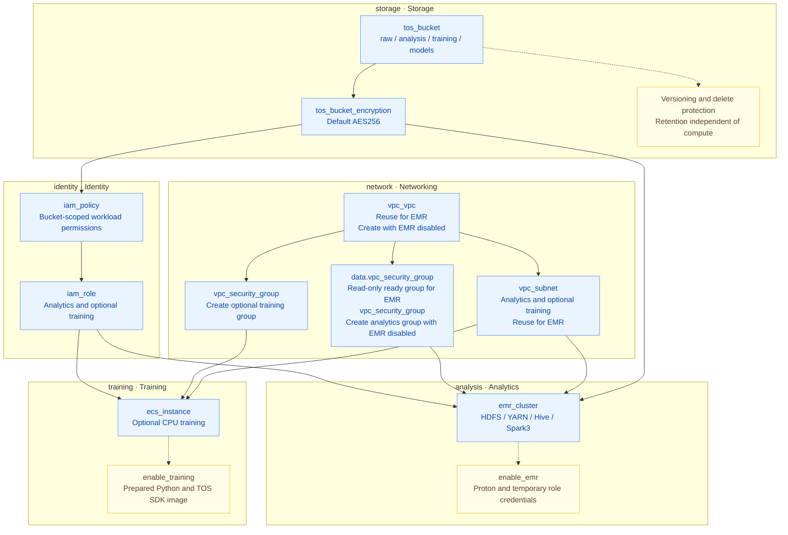

# Quickly Deploy a Cloud-native Enterprise Data Lake

Deploy a TOS and EMR data lake on Volcengine with Terraform, with optional dedicated CPU training compute. Raw data, analytics results, training datasets and models use separate buckets. Analytics and training access data through dedicated workload roles.

## 1. Business Background

Analytics and small model-training workloads need to share data while managing compute and access separately. Common problems include:

- **Mixed data purposes**: Combining raw data, analysis results and models makes read and overwrite permissions difficult to maintain.
- **Coupled compute and data lifecycles**: Data must survive the end of a compute task, and metadata needs to be backed up before compute is released.
- **Incomplete deployment preparation**: Configuring clusters, training images, networking and identities separately can leave jobs unable to run.

This solution uses four buckets, dedicated workload roles and optional compute switches to manage infrastructure for Spark/Hive analytics and CPU training.

## 2. Solution Overview

By default, the template deploys an EMR cluster with one Master and two Core nodes, providing HDFS, YARN, Hive and Spark3. Four TOS buckets separately store raw data, analytics results, training datasets and models, with private access, versioning and default AES256 encryption. Storage and compute are managed separately, allowing data retention when compute is released. Operators upload data, submit jobs and back up metadata.

All four buckets use standard storage without automatic archival. `analysis_scratch_retention_days` is disabled by default and controls expiration of current versions under analysis `scratch/` only, leaving other business paths and historical versions unaffected.

EMR requires an existing VPC, analytics subnet and ready security group. Training on reused networking additionally requires a training subnet; the template creates its security group. With EMR disabled and `existing_network=null`, the template can create networking, adding a training subnet when training is enabled.

To support buckets with versioning enabled or suspended, EMR sets `fs.tos.rename.enabled=false` in `core-site.xml`. Proton uses copy followed by deletion for uploads, moves and trash operations. This requires additional requests and is not atomic: interruptions may leave both source and destination objects. Check Spark/Hive job commit behavior before production use.

The diagram shows resource relationships across five Terraform modules. Solid arrows indicate resource references or creation dependencies, and dotted arrows attach notes; arrows do not represent business traffic.



## 3. IaC Design

### 3.1 Resource Inventory

The current `terraform.tfvars` selects an existing network, password login, analytics enabled and training disabled, corresponding to the Analytics column. The other columns describe different switches. All counts are template-managed objects:

| Terraform Resource | Storage and New Network | Analytics | Analytics + Training | Purpose |
| --- | ---: | ---: | ---: | --- |
| `volcenginecc_tos_bucket` | 4 | 4 | 4 | Separate raw data, analysis results, training datasets and models |
| `volcenginecc_tos_bucket_encryption` | 4 | 4 | 4 | Default AES256 encryption for all buckets |
| `volcenginecc_vpc_vpc` | 1 | 0 | 0 | VPC when creating networking |
| `volcenginecc_vpc_subnet` | 1 | 0 | 0 | Analytics subnet when creating networking, plus a training subnet when enabled |
| `volcenginecc_vpc_security_group` | 1 | 0 | 1 | New analytics or optional training security group |
| `volcenginecc_iam_policy` | 0 | 1 | 2 | One bucket-permission policy per enabled workload |
| `volcenginecc_iam_role` | 0 | 1 | 2 | One instance role per enabled workload |
| `volcenginecc_emr_cluster` | 0 | 1 | 1 | Analytics cluster and inline initial node groups |
| `volcenginecc_ecs_instance` | 0 | 0 | 1 | Dedicated CPU training instance |
| `time_sleep` | 1 | 0 | 1 | Destroy waits for managed VPC or training ECS; creates no cloud resource |
| **Total** | **12** | **11** | **16** | Includes wait objects |

The foundation column uses `enable_emr=false`, `enable_training=false` and `existing_network=null`. Both analytics columns reuse a complete existing network. `emr_deploy_mode` controls Master count: 1 for `SIMPLE` and 3 for `HIGH_AVAILABLE`; Core count is `emr_core_count`, defaulting to 2. Changing node counts does not add separate Terraform cluster resources.

Training alone has 13 managed objects when reusing a VPC, subnets and analytics security group, or 18 when creating networking. Reused networking creates no resources; `data.volcenginecc_vpc_security_group.analysis` only reads a security group and is not counted. EMR-managed ECS, disks and NICs are not additional independent template resources.

### 3.2 Project Structure

```text
.
├── modules/
│   ├── network/              # Networking and security groups
│   │   ├── main.tf
│   │   ├── variables.tf
│   │   ├── outputs.tf
│   │   └── versions.tf
│   ├── storage/              # TOS buckets and encryption
│   │   ├── main.tf
│   │   ├── variables.tf
│   │   ├── outputs.tf
│   │   └── versions.tf
│   ├── identity/             # Roles and policies
│   │   ├── main.tf
│   │   ├── variables.tf
│   │   ├── outputs.tf
│   │   └── versions.tf
│   ├── analysis/             # EMR analytics
│   │   ├── main.tf
│   │   ├── variables.tf
│   │   ├── outputs.tf
│   │   └── versions.tf
│   └── training/             # Optional CPU ECS
│       ├── main.tf
│       ├── variables.tf
│       ├── outputs.tf
│       └── versions.tf
├── main.tf
├── variables.tf
├── outputs.tf
├── providers.tf
├── versions.tf
├── terraform.tfvars
├── jobs/                     # Jobs submitted explicitly by the operator
│   ├── analyze.py
│   └── train.py
├── samples/                  # Public artificial samples; no enterprise data
│   ├── words.txt
│   ├── linear.csv
│   └── sales/
│       ├── dt=2026-01-01/
│       │   └── part.csv
│       └── dt=2026-01-02/
│           └── part.csv
├── README.md
└── README.zh-CN.md
```

The root module configures providers and composes five first-level modules for networking, storage, identities, analytics and training. `jobs/` and `samples/` are manual demonstrations and are not executed during resource deployment.

### 3.3 Key Code Examples

The analytics role reads raw, reads/writes analysis, and denies access to training/model buckets. This excerpt comes from `main.tf`:

```hcl
module "analysis_identity" {
  count            = var.enable_emr ? 1 : 0
  source           = "./modules/identity"
  name             = "${var.name}-analysis"
  enable_emr_trust = true
  read_buckets     = [module.storage.bucket_names.raw]
  write_buckets    = [module.storage.bucket_names.analysis]
  denied_buckets   = [module.storage.bucket_names.training, module.storage.bucket_names.models]
  tags             = local.common_tags
}
```

Buckets are the permission boundary, without tenant isolation between output prefixes. Training uses the same module with read access to training and read/write access to models.

## 4. Usage

This project supports cloud deployment through InfraManager or local deployment using the downloaded template. Cloud deployment is recommended: you do not need to prepare a Terraform runtime, and you can create and manage resources by entering parameters in the platform.

### 4.1 Cloud Deployment

InfraManager is Volcengine's managed Terraform workspace. For more information, see the [InfraManager product introduction](https://docs.volcengine.com/docs/infrastructure-management/product-introduction?lang=zh).

#### 4.1.1 Prepare Permissions

Use a deployment identity authorized to manage this template's resources and configure its credentials in the platform. Required capabilities include:

- Create, read, update and delete TOS buckets and encryption settings, including tags, ACLs, versioning and lifecycle configuration.
- Manage IAM custom policies, roles and policy attachments, and pass workload roles to EMR/ECS.
- With analytics enabled, manage EMR clusters and service-managed nodes, read existing VPCs, subnets and security groups, and authorize the EMR service role.
- With new networking or training enabled, manage the corresponding VPCs, subnets, security groups or ECS instances and read selected images, instance types and key pairs.

See Section 4.2.1 for service activation, network rules, capacity and management access. The data-publisher identity additionally needs permission to upload public samples to input buckets. Jobs use template workload roles rather than the deployment identity's AK/SK.

#### 4.1.2 Select the Template

Open the [InfraManager console](https://console.volcengine.com/iac), go to **Template Management > Public Templates**, and search for “快速部署云原生企业级数据湖”.

#### 4.1.3 Create a Stack

Select the template and click **Create Stack**. Enter the stack information and template parameters for your requirements. Create and review the execution plan, then click **Deploy** after confirming the changes are as expected.

See Section 4.2.1 for parameters and Section 4.2.2 for scenarios. The analytics scenario requires four unique bucket names, an availability zone, an EMR instance type and a complete `existing_network`. For password login, supply `ecs_password` through a sensitive platform input and leave `key_pair_name` empty. There is no default password; password login requires an explicit value.

Training additionally requires a subnet, prepared image and instance type. `environment="prod"` requires both `HIGH_AVAILABLE` and an existing external metadata connection. Use the same stack for updates and compute release. Review cluster replacement actions before changing `owner`, node counts, release or login settings.

#### 4.1.4 Verify the Deployment

Confirm that the deployment status is successful on the stack details page, then review the template outputs:

| Output | Purpose |
| --- | --- |
| `network` | Locate the VPC, analytics subnet and optional training subnet |
| `storage` | Locate buckets, endpoints, input, results, warehouse, metadata backups, training data and model paths |
| `emr_cluster_id` | Locate the analytics cluster; null with analytics disabled |
| `analysis_role_name` | Check the analytics workload role; null with analytics disabled |
| `training` | Locate the training instance, private address and role; null with training disabled |

Outputs contain no password or AK/SK. Check counts against Section 3.1: the analytics example has 11 managed objects and 1 Master with 2 Core nodes.

Obtain actual targets from stack outputs. Select the same region and project in the [EMR console](https://console.volcengine.com/emr/), [TOS console](https://console.volcengine.com/tos/) and [ECS console](https://console.volcengine.com/ecs/), then follow Section 4.2.4 to check resource status, components, data access and permissions. Cloud users use stack outputs directly and do not need local Terraform State.

Analytics checks have platform verification evidence matching the code version. See Section 4.2.4 for instructions and untested areas.

### 4.2 Local Deployment

You can also download and run the template locally by following the steps below.

Run all Terraform commands from the complete template's root directory. Use the same `terraform.tfvars`, workspace and State for updates. Do not create a new local State to manage resources belonging to an existing platform stack.

#### 4.2.1 Prepare the Environment

**Base environment**:

- Terraform constraints are `>= 1.5.0, < 2.0.0`; Terraform 1.5.7 is supported. Prepare Linux/WSL with access to Volcengine APIs and provider download sources.
- Provider constraints are `volcengine/volcenginecc ~> 0.0.74` and `hashicorp/time = 0.14.2`; the latter supplies wait objects only. Verification used `volcenginecc 0.0.74`, so recheck other compatible versions.
- For production, use remote State with locking and encryption. Protect local State and saved plans.

**Services and quotas**:

1. Activate the required services in the TOS, EMR and ECS consoles. Configure the permissions in Section 4.1.1 and confirm capacity and quotas for the selected region, instance types, EMR release and disk type.

2. Complete service authorization in the EMR console and confirm that `ServiceRoleForEMR` exists in IAM role management.

3. Before enabling analytics, prepare a VPC in the selected region, an analytics subnet in the selected zone and a ready security group in that VPC. It must allow all-port ingress from itself and have exactly one allow-all egress rule to `0.0.0.0/0` at priority 100. Restrict additional management ingress to authorized sources; the template only reads this reused group and does not modify its rules.

4. Prepare an existing VPN, private connection, bastion or working Cloud Assistant for private node management. The template does not create EIPs, NAT or install Cloud Assistant. If using Cloud Assistant, check its client status in the ECS console before submitting jobs.

5. For key-pair login, prepare an existing key pair in the selected region. Training additionally requires a subnet in the selected zone and a prepared Linux image containing Python 3 and a TOS SDK with `TosClientV2` and `EcsCredentialsProvider`. Without public access or NAT, prepare the software in the image.

**Credential injection** (environment variables are recommended; do not store credentials in code or `tfvars`):

```bash
export VOLCENGINE_ACCESS_KEY="your_access_key"
export VOLCENGINE_SECRET_KEY="your_secret_key"
export VOLCENGINE_REGION="cn-beijing"
```

`providers.tf` explicitly uses `var.region`; that parameter controls the region, and `VOLCENGINE_REGION` does not override it. If using temporary credentials, also supply `VOLCENGINE_SESSION_TOKEN` through the protected execution environment.

**Sensitive business variables**: `ecs_password` is sensitive and supplies the initial login password for EMR and training ECS in password mode. It defaults to `null` and must be supplied for password login; do not store it in `terraform.tfvars`:

```bash
export TF_VAR_ecs_password="<your-initial-password>"
```

Passwords require 8–30 supported characters and at least three of uppercase, lowercase, digits and special characters. They enter State and saved plans; `sensitive` only hides normal display. A variable-file assignment overrides `TF_VAR_*`; ensure that `terraform.tfvars` does not define `ecs_password`.

**Key parameters**:

The table covers all root inputs, with defaults from `variables.tf`. `terraform.tfvars` provides a password-login example with existing networking, analytics enabled and training disabled. Replace its placeholders before deployment.

| Parameter | Type | Default / Input Requirement | Description |
| --- | --- | --- | --- |
| `region` | string | `cn-beijing` | Same region for compute and TOS |
| `zone_id` | string | Required | Zone supporting selected EMR/ECS instance types |
| `name` | string | `enterprise-data-lake` | Prefix of 3–32 lowercase letters, digits or hyphens, beginning with a letter |
| `environment` | string | `demo` | `demo`, `test` or `prod`; production analytics requires high availability and external metadata |
| `project_name` | string | `default` | Existing resource project |
| `owner` | string | `data-platform` | Non-sensitive team label; check cluster replacement before updating |
| `cost_center` | string | `data-platform` | Cost-allocation label |
| `bucket_names` | object | Required | `raw`, `analysis`, `training`, `models`: four distinct, globally unique valid bucket names |
| `tos_endpoint` | string | `null` | Derived as `https://tos-<region>.ivolces.com`; overrides must be HTTPS service endpoints without paths or credentials |
| `vpc_cidr` | string | `10.42.0.0/16` | VPC IPv4 CIDR; supply the actual CIDR when reusing |
| `emr_subnet_cidr` | string | `10.42.1.0/24` | Analytics subnet CIDR; supply the actual CIDR when reusing |
| `training_subnet_cidr` | string | `10.42.2.0/24` | Separate training subnet CIDR |
| `existing_network` | object | `null` | `vpc_id`, `emr_subnet_id`; analytics requires `emr_security_group_id`, and training on reused networking requires `training_subnet_id` |
| `management_cidrs` | set(string) | `[]` | Authorized management IPv4 CIDRs; `/0` forbidden; applies to new groups, while owners maintain reused EMR rules |
| `enable_emr` | bool | `true` | Creates analytics compute; disabling removes the cluster and analytics identity |
| `emr_release_version` | string | `3.19.0` | Must support HDFS, YARN, HIVE, SPARK3 and Proton |
| `emr_instance_type` | string | Required | Available EMR-supported instance type |
| `emr_disk_type` | string | `ESSD_FlexPL` | Disk type compatible with the region, zone and release |
| `emr_deploy_mode` | string | `SIMPLE` | 1 Master for `SIMPLE`, or 3 in one zone for `HIGH_AVAILABLE` |
| `emr_core_count` | number | `2` | Core count, integer 2–1000; check replacement before changing |
| `key_pair_name` | string | `null` | Existing key pair required in key mode; empty in password mode |
| `ecs_login_mode` | string | `key_pair` | `key_pair` or `password`, shared by analytics and training |
| `ecs_password` | string, sensitive | `null` | Required in password mode; use sensitive injection above without publishing the value |
| `metastore` | object | `{}` | `connection_type` defaults to `BUILT_IN_MYSQL`, `connection_id` to empty; `EXTERNAL_MYSQL` and `HIVE_METASTORE` require an existing connection ID |
| `enable_training` | bool | `false` | Creates one CPU training instance and dedicated identity; disabling removes those compute objects |
| `training_image_id` | string | `null` | Prepared Linux image required when training is enabled |
| `training_instance_type` | string | `null` | Available CPU ECS instance type required when training is enabled |
| `analysis_scratch_retention_days` | number | `0` | Nonnegative integer; 0 disables expiration, affecting current versions under analysis `scratch/` only |
| `eni_release_wait_seconds` | number | `120` | Integer 0–900; wait after training ECS deletion before security group removal; 0 disables |
| `vpc_child_release_wait_seconds` | number | `120` | Integer 0–900; wait after managed subnet/group deletion before VPC removal; excludes reused networking |

#### 4.2.2 Scenario-based Deployment Examples

Initialize and validate:

```bash
terraform init
terraform fmt -check -recursive
terraform validate
```

**Analytics: reuse ready networking**

Root `terraform.tfvars` already provides a complete analytics example. Edit that file:

- Replace all four `bucket_names` with globally unique names.
- Confirm valid `region`, `zone_id` and `emr_instance_type`, and set the three CIDR inputs to the actual network ranges.
- Inject the password as described in Section 4.2.1 and supply these existing network identifiers:

```hcl
existing_network = {
  vpc_id                = "vpc-xxxxxxxx"
  emr_subnet_id         = "subnet-xxxxxxxx"
  emr_security_group_id = "sg-xxxxxxxx"
}
```

```bash
terraform plan -out=deploy.tfplan
terraform apply deploy.tfplan
```

Before Apply, check that the plan creates only the required analytics resources, without unexpected replacement or deletion.

For key-pair login, change the same parameter file as follows; the root module passes no password to compute:

```hcl
ecs_login_mode = "key_pair"
key_pair_name  = "replace-with-existing-keypair"
```

**Analytics + training: complete training prerequisites**

Add `training_subnet_id` to the original `existing_network` object, retaining its other three fields. Add these values to the same parameter file:

```hcl
enable_training        = true
training_image_id      = "replace-with-prepared-image-id"
training_instance_type = "replace-with-available-instance-type"
```

```bash
terraform plan -out=training.tfplan
terraform apply training.tfplan
```

The plan should add training ECS, a role, a policy, a security group and a wait object. Prepare training software in the image first.

For training alone, set `enable_emr=false`. Reuse existing networking or set `existing_network=null` to create a VPC, analytics and training subnets, and security groups. Deploy with the same Plan/Apply workflow. Required root inputs still need values even with EMR disabled.

**Foundation: storage and networking only**

For a new deployment, set `enable_emr=false`, `enable_training=false` and `existing_network=null`. Supply non-overlapping CIDRs and other required inputs from Section 4.2.1, then use the analytics example's Plan/Apply commands. Expect buckets, encryption and foundation networking only, without workload compute or roles. Do not run analytics or training jobs in this scenario.

See Section 4.2.5 to release compute in an existing EMR environment. Disabling a switch removes compute rather than pausing services.

#### 4.2.3 Expected Deployment Results

Check scenario counts against Section 3.1, then view outputs:

```bash
terraform output
```

See Section 4.1.4 for output purposes. Check actual bucket names, same-region private endpoints and outputs for the selected compute. Paths are location conventions, not evidence of existing data or backups.

Disabling analytics makes `emr_cluster_id` and `analysis_role_name` null; disabling training makes `training` and `network.training_subnet_id` null.

#### 4.2.4 Post-deployment Verification

Identify targets from local or stack outputs and run these checks on the corresponding compute nodes and service consoles.

Platform verification matching the code version covered analytics, partition queries, bucket permissions, failure recovery and metadata restoration. Enabled training, actual expiration, post-release retention, local initial deployment and post-deployment idempotence remain untested. Check the features selected; do not enable training or release compute solely to verify analytics.

**Resources and components**

| Where to Check | Expected Result | First Troubleshooting Steps |
| --- | --- | --- |
| TOS console, all four actual buckets | Private, versioning `Enabled`, default encryption `AES256`, standard storage | Region, project, bucket names, ACL and encryption configuration |
| EMR console, the output-identified cluster | Running; nodes match deployment mode and Core input; healthy HDFS/YARN/Hive/Spark3 | Capacity, node events, communication within the group and EMR authorization |
| EMR component configuration | Correct `fs.tos.endpoint`, region and role credentials; `fs.tos.rename.enabled=false`; Hive warehouse uses analysis `warehouse/managed` and `warehouse/external` | Same-region endpoint, applied configuration and instance roles |
| ECS console, actual nodes | No public IP; analytics nodes bind `analysis_role_name`, training binds `training.role_name` | Subnet, security group, role passing and instance-role association |
| TOS lifecycle settings | Analysis rule covers `scratch/` only; 0 days means `Disabled`; other data purposes do not automatically expire | Rule prefix, switch and retention needs; keep long-running job inputs outside scratch storage |

With storage and networking only, check the buckets, VPC, subnet and security group; do not submit compute jobs.

**Analytics: upload public samples and compare actual results**

1. With the data-publisher identity, upload `samples/words.txt` through the TOS console to raw `input/words.txt`. Upload both `samples/sales/dt=.../part.csv` files to their corresponding `input/sales/dt=.../part.csv` paths. Preserve paths and CSV contents; expected counts and queries are listed below.

2. Through the prepared management entry, copy the complete template's `jobs/` directory into an EMR Master working directory readable by `spark`. Run there as `spark`. Check that `java -version` works and `JAVA_HOME` points to installed Java. The following component paths apply to the current EMR release; check installation paths for other releases:

```bash
export SPARK_HOME="/usr/lib/emr/current/spark3"
export HADOOP_CONF_DIR="/etc/emr/hadoop/conf"
export HIVE_CONF_DIR="/etc/emr/hive/conf"
export JAVA_HOME="$(dirname "$(dirname "$(readlink -f "$(command -v java)")")")"
export RAW_BUCKET="<raw-bucket>"
export ANALYSIS_BUCKET="<analysis-bucket>"
export RUN_ID="run_001"
timeout 20m "$SPARK_HOME/bin/spark-submit" \
  --master yarn --deploy-mode client \
  --num-executors 2 --executor-memory 1g --driver-memory 1g \
  jobs/analyze.py \
  --raw-bucket "$RAW_BUCKET" \
  --analysis-bucket "$ANALYSIS_BUCKET" \
  --run-id "$RUN_ID" > "$RUN_ID.log" 2>&1
task_exit=$?
printf '%s\n' "$task_exit"
tail -n 30 "$RUN_ID.log"
```

Replace bucket names and use a new `RUN_ID` for each job: 3–41 lowercase letters, digits or underscores, beginning with a letter. Compare results after exit 0 and `PASS wordcount=`. Inspect logs on failure or timeout exit 124; a YARN client-mode success marker does not replace actual results.

3. In TOS, inspect analysis `results/<run-id>/wordcount/`. Open every `part-*.json` and compare word counts rather than checking `_SUCCESS` alone. Query `lake_acceptance.sales_<run-id>` through the Spark SQL client:

```sql
DESCRIBE lake_acceptance.sales_run_001;
SHOW PARTITIONS lake_acceptance.sales_run_001;
SELECT COUNT(*) FROM lake_acceptance.sales_run_001;
SELECT category, SUM(amount) FROM lake_acceptance.sales_run_001 GROUP BY category;
SELECT dt, COUNT(*) FROM lake_acceptance.sales_run_001 GROUP BY dt;
DESCRIBE FORMATTED lake_acceptance.sales_run_001;
```

Replace `run_001` in SQL table names when using another run identifier.

| Check | Expected Result |
| --- | --- |
| Word counts | `cloud=2`, `lake=2`, `spark=1` |
| Fields | `id:int`, `category:string`, `amount:int`, `dt:string` |
| Records and aggregates | 4 rows; `a=40`, `b=60` |
| Partitions | `dt=2026-01-01`, `dt=2026-01-02`, 2 rows each |
| Actual table location | Raw `input/sales/`, with the corresponding date directories for partitions |

For mismatches, first check upload paths, sample contents, delimiters and metadata locations. For access failures, inspect instance roles, bucket policies, same-region endpoints and private connectivity. Do not add deployment AK/SK to jobs.

**Analytics permissions and recoverable failures**

Successful analytics already confirms raw reads and analysis writes. As the same `spark` user, run the negative checks below, substituting training and model bucket names:

```bash
/usr/lib/emr/current/hadoop/bin/hadoop fs -touchz "tos://$RAW_BUCKET/input/permission_probe.txt"
/usr/lib/emr/current/hadoop/bin/hadoop fs -ls "tos://<training-bucket>/"
/usr/lib/emr/current/hadoop/bin/hadoop fs -ls "tos://<models-bucket>/"
```

Each command should return a nonzero status and explicitly report `AccessDenied` or HTTP 403. A 404, timeout or DNS failure does not establish permission isolation. If a negative check unexpectedly succeeds, stop, remove only the probe object created by this check, and inspect the role policy.

To check recovery, use a new `RUN_ID` and add `--fail-before-write` before output redirection. Confirm failure before writing and no output, then remove the flag and retry the same identifier. Expect success and identical statistics. Successful identifiers must refuse overwriting.

**Metadata backup and restoration**

In the EMR Spark SQL client, use the actual table name:

```sql
SHOW CREATE TABLE lake_acceptance.sales_run_001 AS SERDE;
SHOW PARTITIONS lake_acceptance.sales_run_001;
```

Upload the complete DDL and partition results to analysis `metadata-backups/<run-id>/` and reread them. To verify restoration, use the saved DDL to create `lake_acceptance.sales_run_001_restored`, preserving fields and data locations. Add these partitions, substituting the actual raw bucket:

```sql
ALTER TABLE lake_acceptance.sales_run_001_restored
ADD PARTITION (dt='2026-01-01')
LOCATION 'tos://<raw-bucket>/input/sales/dt=2026-01-01/';
ALTER TABLE lake_acceptance.sales_run_001_restored
ADD PARTITION (dt='2026-01-02')
LOCATION 'tos://<raw-bucket>/input/sales/dt=2026-01-02/';
SELECT category, SUM(amount) FROM lake_acceptance.sales_run_001_restored GROUP BY category;
```

Fields, counts, partitions and aggregates must match the original. Preserve the original table and raw data; operators perform metadata backups.

**Training: run only when enabled**

With training disabled, confirm the absence of independent training ECS, roles, policies and security groups. Do not enable training just to complete analytics verification.

With training enabled, first check in ECS that the instance is running, privately manageable and bound to the training role. Upload `samples/linear.csv` as the publisher to training `datasets/linear.csv`, and copy `jobs/train.py` to the training working directory. From the directory containing `jobs/`, check `python3 -c 'import tos; print(tos.TosClientV2, tos.EcsCredentialsProvider)'`, then run:

```bash
timeout 5m python3 jobs/train.py \
  --region "<region>" \
  --endpoint "https://tos-<region>.ivolces.com" \
  --role-name "<training-role>" \
  --training-bucket "<training-bucket>" \
  --models-bucket "<models-bucket>" \
  --run-id train_001
```

Use deployment outputs for arguments: `storage.configured_endpoint` for the service endpoint and `training.role_name` for the role. Expect `PASS`, slope 2, intercept 1, 4 samples, near-zero error and prediction 9 for input 4. The model bucket should contain readable `models/train_001/linear.json`. Use new identifiers for new runs; duplicate identifiers reject writes.

For failures, check Python/TOS SDK in the image, instance roles, sample paths and private connectivity. Reads from raw or analysis using the same training role through TOS SDK should be explicitly denied. Hadoop is unnecessary, and the script creates no online inference service.

**Logs, repeated plans and sample cleanup**

Job logs are stored in the working directory; inspect resource usage in EMR/ECS monitoring. After interrupting a client, check YARN for remaining tasks and stop only this job. `timeout` does not guarantee that a submitted remote job stops.

After local deployment, run `terraform plan -detailed-exitcode` twice. Both should return 0; 1 indicates an error and 2 indicates remaining changes. Cloud users should create a plan in the same stack and verify no pending changes.

Keep public samples and results for review if needed. Cleanup should remove only this run's results, models and test tables; dropping a Hive external table does not delete raw data. Versioned buckets and Hadoop trash may retain objects. Preserve inputs and backups used by other jobs.

#### 4.2.5 Destroy Resources

Buckets use `prevent_destroy=true`, so direct whole-stack destruction is unavailable by default. The built-in metastore is released with the cluster: back up and reread metadata, then stop jobs. In the `terraform.tfvars` used for the original deployment, set `enable_emr=false` and `enable_training=false`, preserving all other inputs:

```bash
terraform plan -out=release.tfplan
terraform apply release.tfplan
```

Review that the plan removes only compute, runtime identities and the optional training security group, retaining buckets and existing networking. Cloud users disable switches and deploy in the same stack. Afterwards verify compute removal and continued access to data and backups.

Full cleanup requires the data owner's decision. Remove object versions, delete markers, incomplete uploads and trash first, then have the template maintainer remove storage deletion protection and review destruction using the original stack or State. Reused networking remains under its owner's control; check other dependencies before removing managed networking. No immediately executable whole-stack destroy command is provided here.

`eni_release_wait_seconds` and `vpc_child_release_wait_seconds` apply during destruction and must be deployed into the same State before release. Fixed waits do not replace actual cloud-status checks. TOS deletion may finish asynchronously; use final console task and resource status, and do not repeat deletion merely because a bucket temporarily disappears.

## 5. Summary

This solution supports Spark/Hive analytics and small CPU training workloads on TOS, with purpose-specific storage, dedicated workload roles and independently selectable compute.

Operators upload data, submit jobs and back up metadata. Private compute requires a management entry; training includes no GPU stack or online model service. Production analytics requires external metadata and high availability within one zone, with monitoring and disaster recovery planned separately.

See the [official Provider documentation](https://registry.terraform.io/providers/volcengine/volcenginecc/0.0.74/docs) for resource fields and interfaces.
