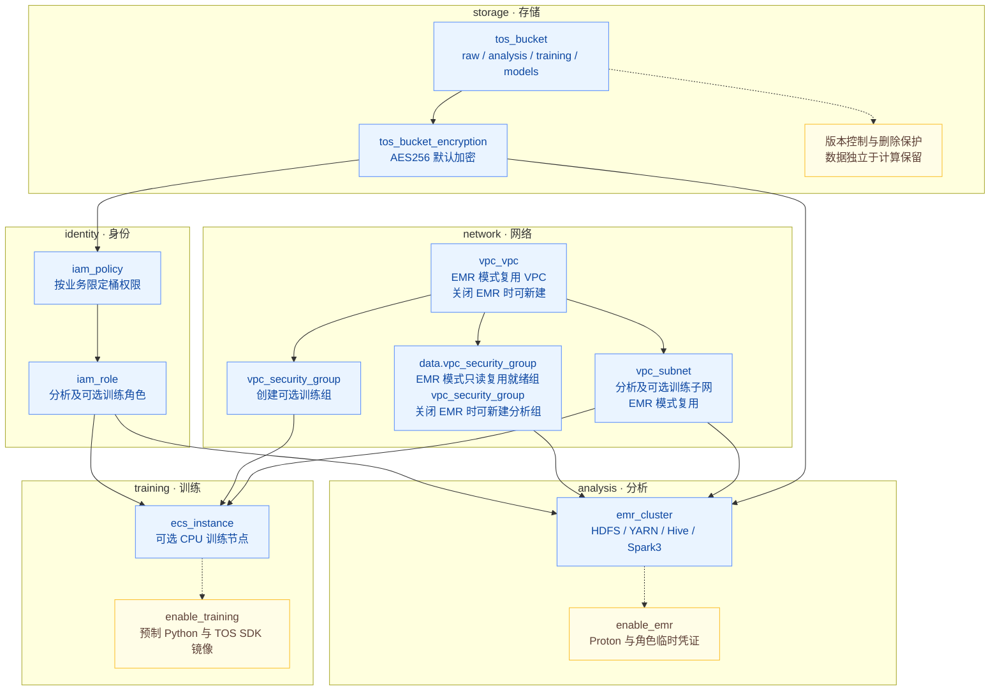

# 快速部署云原生企业级数据湖

使用 Terraform 在火山引擎部署基于 TOS 和 EMR 的数据湖，并可选配独立 CPU 训练节点。原始数据、分析结果、训练数据与模型分桶存储，分析和训练使用独立角色访问数据。

## 1. 业务背景

数据分析与小规模模型训练需要共享数据，同时分别管理计算资源和访问权限，常见问题包括：

- **数据混放**：原始数据、分析结果和模型放在一起，难以确定谁可以读取或覆盖。
- **计算与数据生命周期混在一起**：结束计算任务后仍要保留数据，元数据库也需要提前备份。
- **部署准备不完整**：分析集群、训练镜像、网络和身份分别配置，遗漏一个环节就可能导致作业无法运行。

本方案通过四个存储桶、独立业务角色和可选计算开关，统一管理 Spark/Hive 分析与 CPU 训练所需的基础设施。

## 2. 方案概述

默认部署 1 Master + 2 Core 的 EMR 集群，提供 HDFS、YARN、Hive 和 Spark3。四个 TOS 桶分别存放原始数据、分析结果、训练数据和模型，均采用私有访问、版本控制和 AES256 默认加密。存储与计算分别管理，释放计算时可保留数据；数据上传、作业提交和元数据备份由操作者完成。

四桶默认使用标准存储，不自动归档。`analysis_scratch_retention_days` 默认关闭，仅控制分析桶 `scratch/` 当前版本的过期，不影响其他业务目录和历史版本。

启用 EMR 需复用已有 VPC、分析子网和就绪安全组。复用网络并启用训练时，需另行提供训练子网，模板创建训练安全组。关闭 EMR 且 `existing_network=null` 时，模板可新建网络，并按训练开关决定是否创建训练子网。

为兼容启用或暂停的桶版本控制，EMR 在 `core-site.xml` 中设置 `fs.tos.rename.enabled=false`，由 Proton 通过复制后删除完成上传、移动和回收站操作。该过程会增加请求，且不具备原子性；中断时可能同时保留源和目标对象，生产使用前应核验 Spark/Hive 作业提交行为。

下图按五个 Terraform 模块展示资源关系：实线表示资源引用或创建依赖，虚线连接备注，箭头不代表业务流量。



## 3. IaC 设计

### 3.1 资源清单

当前 `terraform.tfvars` 选择已有网络、密码登录、启用分析且关闭训练，对应下表“分析”列。其他列用于说明开关改变后的数量，均为模板受管对象：

| Terraform 资源 | 基础存储与新建网络 | 分析 | 分析 + 训练 | 用途 |
| --- | ---: | ---: | ---: | --- |
| `volcenginecc_tos_bucket` | 4 | 4 | 4 | 原始数据、分析结果、训练数据和模型分桶 |
| `volcenginecc_tos_bucket_encryption` | 4 | 4 | 4 | 四桶默认 AES256 加密 |
| `volcenginecc_vpc_vpc` | 1 | 0 | 0 | 新建网络时创建 VPC |
| `volcenginecc_vpc_subnet` | 1 | 0 | 0 | 新建网络时创建分析子网，启用训练时另建训练子网 |
| `volcenginecc_vpc_security_group` | 1 | 0 | 1 | 新建分析安全组或可选训练安全组 |
| `volcenginecc_iam_policy` | 0 | 1 | 2 | 每条启用的业务链路各一个桶权限策略 |
| `volcenginecc_iam_role` | 0 | 1 | 2 | 每条启用的业务链路各一个实例角色 |
| `volcenginecc_emr_cluster` | 0 | 1 | 1 | 分析集群及内嵌初始节点组 |
| `volcenginecc_ecs_instance` | 0 | 0 | 1 | 独立 CPU 训练节点 |
| `time_sleep` | 1 | 0 | 1 | 受管 VPC 或训练 ECS 的销毁等待，不创建云资源 |
| **合计** | **12** | **11** | **16** | 包含等待对象 |

基础列对应 `enable_emr=false`、`enable_training=false`、`existing_network=null`；分析两列均复用完整已有网络。EMR 的 Master 数量由 `emr_deploy_mode` 决定：`SIMPLE` 为 1，`HIGH_AVAILABLE` 为 3；Core 数量为 `emr_core_count`，默认 2。节点数变化不增加独立的 Terraform 集群资源条目。

仅训练且复用已有 VPC、子网和分析安全组时为 13 个受管对象；仅训练且新建网络时为 18 个。已有网络不创建资源，`data.volcenginecc_vpc_security_group.analysis` 只读查询安全组，不计入创建数量。EMR 内部 ECS、磁盘和网卡由服务管理，不另计为模板独立资源。

### 3.2 工程结构

```text
.
├── modules/
│   ├── network/              # 网络与安全组
│   │   ├── main.tf
│   │   ├── variables.tf
│   │   ├── outputs.tf
│   │   └── versions.tf
│   ├── storage/              # TOS 桶与加密
│   │   ├── main.tf
│   │   ├── variables.tf
│   │   ├── outputs.tf
│   │   └── versions.tf
│   ├── identity/             # 角色与策略
│   │   ├── main.tf
│   │   ├── variables.tf
│   │   ├── outputs.tf
│   │   └── versions.tf
│   ├── analysis/             # EMR 分析
│   │   ├── main.tf
│   │   ├── variables.tf
│   │   ├── outputs.tf
│   │   └── versions.tf
│   └── training/             # 可选 CPU ECS
│       ├── main.tf
│       ├── variables.tf
│       ├── outputs.tf
│       └── versions.tf
├── main.tf
├── variables.tf
├── outputs.tf
├── providers.tf
├── versions.tf
├── terraform.tfvars
├── jobs/                     # 由操作者显式提交的业务作业
│   ├── analyze.py
│   └── train.py
├── samples/                  # 公开人工样本，不含企业数据
│   ├── words.txt
│   ├── linear.csv
│   └── sales/
│       ├── dt=2026-01-01/
│       │   └── part.csv
│       └── dt=2026-01-02/
│           └── part.csv
├── README.md
└── README.zh-CN.md
```

根模块负责资源编排与 Provider 配置，五个一级子模块分别负责网络、存储、身份、分析和训练。`jobs/` 与 `samples/` 只提供人工演示，不在资源部署时自动执行。

### 3.3 核心代码示例

分析角色只读 raw 桶、读写 analysis 桶，并拒绝访问训练和模型桶。以下节选自 `main.tf`：

```hcl
module "analysis_identity" {
  count            = var.enable_emr ? 1 : 0
  source           = "./modules/identity"
  name             = "${var.name}-analysis"
  enable_emr_trust = true
  read_buckets     = [module.storage.bucket_names.raw]
  write_buckets    = [module.storage.bucket_names.analysis]
  denied_buckets   = [module.storage.bucket_names.training, module.storage.bucket_names.models]
  tags             = local.common_tags
}
```

权限边界为桶，不提供输出桶内部不同目录的租户隔离。训练角色使用相同模块，权限限定为读取 training、读写 models。

## 4. 使用说明

本工程支持通过 InfraManager 在云上一键部署或下载模板在本地运行。推荐使用云上部署方式，无需自行准备 Terraform 运行环境，只需在平台填写参数即可完成资源创建和托管。

### 4.1 云上部署

InfraManager 是火山引擎提供的 Terraform 托管工作台，更多产品介绍参见 [InfraManager 产品介绍](https://docs.volcengine.com/docs/infrastructure-management/product-introduction?lang=zh)。

#### 4.1.1 准备权限

使用具备本模板资源管理权限的部署身份，在平台配置授权凭证。需要：

- 创建、读取、更新和删除 TOS 桶及加密配置，管理桶标签、访问控制、版本控制和生命周期。
- 创建和管理 IAM 自定义策略、角色及策略关联，并允许将业务角色传递给 EMR/ECS。
- 启用分析时，创建和管理 EMR 集群及服务托管节点；读取已有 VPC、子网、安全组，完成 EMR 服务角色授权。
- 新建网络或启用训练时，管理对应 VPC、子网、安全组或 ECS，并读取所选镜像、规格和密钥对。

服务开通、网络规则、实例库存和管理入口的准备见第 4.2.1 节。数据上传身份还需向输入桶上传公开样本的权限；作业运行时使用模板业务角色，不使用部署身份的 AK/SK。

#### 4.1.2 选择模板

打开 [InfraManager 控制台](https://console.volcengine.com/iac)，进入 **模板管理 > 公开模板**，搜索“快速部署云原生企业级数据湖”。

#### 4.1.3 创建资源栈

选择模板并点击 **创建资源栈**，根据实际需求填写资源栈信息和模板参数。创建并检查执行计划，确认变更符合预期后，点击 **执行部署**。

参数含义见第 4.2.1 节，场景配置见第 4.2.2 节。默认分析场景应填写四个唯一桶名、可用区、EMR 规格，以及完整 `existing_network`。密码模式通过平台敏感参数填写 `ecs_password`，将 `key_pair_name` 留空；密码没有默认值，使用密码登录时必须显式提供。

启用训练还需训练子网、预制镜像与实例规格。`environment="prod"` 时，必须同时使用 `HIGH_AVAILABLE` 和已有外部元数据连接。已有资源栈更新或释放计算应继续使用同一资源栈；更改 `owner`、节点数、版本或登录配置前，检查计划是否会替换集群。

#### 4.1.4 部署验证

在资源栈详情页查看部署状态为“成功”，再查看模板输出：

| 输出 | 用途 |
| --- | --- |
| `network` | 查看 VPC、分析子网和可选训练子网 |
| `storage` | 定位四桶、服务端点、输入、结果、仓库、元数据备份、训练数据和模型路径 |
| `emr_cluster_id` | 定位分析集群，关闭分析时为空 |
| `analysis_role_name` | 核对分析节点的业务角色，关闭分析时为空 |
| `training` | 定位训练实例、私网地址和角色，关闭训练时为空 |

输出不包含密码或 AK/SK。按第 3.1 节核对资源数量，当前分析案例对应 11 个受管对象和 1 Master、2 Core。

从资源栈输出取得实际目标，在 [EMR 控制台](https://console.volcengine.com/emr/)、[TOS 控制台](https://console.volcengine.com/tos/) 和 [ECS 控制台](https://console.volcengine.com/ecs/) 选择相同地域及项目，再按第 4.2.4 节完成状态、组件、数据读写和权限验证。云上用户直接使用资源栈输出，不需要下载或建立本地 Terraform State。

分析检查已有匹配代码版本的平台实测依据，具体操作和未测范围见第 4.2.4 节。

### 4.2 本地部署

您也可以下载本工程模板在本地运行，需要按照下述步骤操作。

以下 Terraform 命令均在完整模板根目录运行。使用同一个 `terraform.tfvars`、工作区和 State 完成后续更新；不要用新的本地 State 接管已有平台资源栈。

#### 4.2.1 环境准备

**基础环境**：

- Terraform 版本约束为 `>= 1.5.0, < 2.0.0`，可使用 Terraform 1.5.7；准备可访问火山引擎 API 和 Provider 下载源的 Linux/WSL 环境。
- Provider 约束为 `volcengine/volcenginecc ~> 0.0.74` 和 `hashicorp/time = 0.14.2`，后者只提供等待对象。验证基线为 `volcenginecc 0.0.74`，其他兼容版本需重新核对。
- 生产环境应使用具备锁和加密能力的远端 State；保护本地 State 与保存的 Plan。

**服务与配额**：

1. 在 TOS、EMR、ECS 控制台开通所需服务，配置第 4.1.1 节所述部署权限，确认所选地域、实例规格、EMR 版本及磁盘类型有库存和配额。

2. 在 EMR 控制台完成服务授权，确认 IAM 角色管理中已存在 `ServiceRoleForEMR`。

3. 启用分析前，在 VPC 控制台准备同地域 VPC、同可用区分析子网及属于该 VPC 的就绪安全组。安全组须允许所有端口的组内自引用入站，且有且仅有一条优先级 100、面向 `0.0.0.0/0` 的所有流量放行出站规则。额外管理入站只开放授权来源；模板只读复用此安全组，不代改规则。

4. 确认已有 VPN、专线、堡垒机或可用云助手能够管理私网节点。模板不创建 EIP、NAT 或安装云助手；如果采用云助手，先在 ECS 控制台确认客户端正常，再提交作业。

5. 密钥模式准备所选地域的已有密钥对。训练模式另需同可用区训练子网和预装 Python 3、TOS SDK 的 Linux 镜像；SDK 应提供 `TosClientV2` 和 `EcsCredentialsProvider`。没有公网/NAT 时，所需软件应在镜像中准备好。

**凭证注入**（推荐环境变量，不要写入代码或 `tfvars`）：

```bash
export VOLCENGINE_ACCESS_KEY="your_access_key"
export VOLCENGINE_SECRET_KEY="your_secret_key"
export VOLCENGINE_REGION="cn-beijing"
```

`providers.tf` 显式使用 `var.region`，以参数中的地域为准，`VOLCENGINE_REGION` 不覆盖该参数。若使用临时凭证，还需通过受保护的执行环境提供 `VOLCENGINE_SESSION_TOKEN`。

**敏感业务变量**：`ecs_password` 为敏感字段，用于密码模式下 EMR 和训练 ECS 的初始登录。默认值为 `null`，使用密码登录时必须提供，不要写入 `terraform.tfvars`：

```bash
export TF_VAR_ecs_password="<your-initial-password>"
```

密码须为 8–30 个支持的字符，至少包含大写、小写、数字、特殊字符中的三类。密码会进入 State 和保存的 Plan，`sensitive` 只隐藏常规显示。参数文件中的同名变量优先于 `TF_VAR_*`；确认 `terraform.tfvars` 未定义 `ecs_password`，否则环境注入值不会生效。

**重点参数**：

下表覆盖根模块全部参数，默认值来自 `variables.tf`。`terraform.tfvars` 提供密码登录、复用网络、启用分析且关闭训练的案例，部署前替换其中的占位值。

| 参数 | 类型 | 默认值 / 输入要求 | 说明 |
| --- | --- | --- | --- |
| `region` | string | `cn-beijing` | 计算与 TOS 使用同一地域 |
| `zone_id` | string | 必填 | 同地域内支持所选 EMR/ECS 规格的可用区 |
| `name` | string | `enterprise-data-lake` | 名称前缀，3–32 位小写字母、数字或连字符，以字母开头 |
| `environment` | string | `demo` | 可选 `demo`、`test`、`prod`；生产分析需高可用和外部元数据 |
| `project_name` | string | `default` | 已有资源项目 |
| `owner` | string | `data-platform` | 非敏感责任团队标签；更新前检查集群替换 |
| `cost_center` | string | `data-platform` | 成本归属标签 |
| `bucket_names` | object | 必填 | 包含 `raw`、`analysis`、`training`、`models`，四个不同且全局唯一的合法桶名 |
| `tos_endpoint` | string | `null` | 自动使用 `https://tos-<region>.ivolces.com`；自定义值须为无路径、无凭据的 HTTPS 服务端点 |
| `vpc_cidr` | string | `10.42.0.0/16` | VPC IPv4 网段，复用时填实际网段 |
| `emr_subnet_cidr` | string | `10.42.1.0/24` | 分析子网网段，复用时填实际网段 |
| `training_subnet_cidr` | string | `10.42.2.0/24` | 独立训练子网网段 |
| `existing_network` | object | `null` | 包含 `vpc_id`、`emr_subnet_id`；分析开启需 `emr_security_group_id`，训练开启且复用网络需 `training_subnet_id` |
| `management_cidrs` | set(string) | `[]` | 授权 IPv4 管理来源，禁止 `/0`；控制新建安全组，复用 EMR 组仍由网络所有者维护 |
| `enable_emr` | bool | `true` | 开启创建分析计算，关闭会删除集群及分析身份 |
| `emr_release_version` | string | `3.19.0` | 须支持 HDFS、YARN、HIVE、SPARK3 与 Proton |
| `emr_instance_type` | string | 必填 | EMR 支持且有库存的实例规格 |
| `emr_disk_type` | string | `ESSD_FlexPL` | 与地域、可用区及版本兼容的磁盘类型 |
| `emr_deploy_mode` | string | `SIMPLE` | `SIMPLE` 为 1 Master，`HIGH_AVAILABLE` 为同可用区 3 Master |
| `emr_core_count` | number | `2` | Core 数量，整数 2–1000；修改前检查是否替换 |
| `key_pair_name` | string | `null` | 密钥模式必填已有密钥对；密码模式留空 |
| `ecs_login_mode` | string | `key_pair` | 可选 `key_pair`、`password`，同时作用于分析和训练 |
| `ecs_password` | string，敏感 | `null` | 密码模式必填；按上面的敏感输入方式提供，不展示密码值 |
| `metastore` | object | `{}` | `connection_type` 默认为 `BUILT_IN_MYSQL`，`connection_id` 默认为空；`EXTERNAL_MYSQL`、`HIVE_METASTORE` 需已有连接 ID |
| `enable_training` | bool | `false` | 开启创建一个 CPU 训练节点及独立身份，关闭删除这些计算对象 |
| `training_image_id` | string | `null` | 训练开启时必填预制 Linux 镜像 |
| `training_instance_type` | string | `null` | 训练开启时必填可用 CPU ECS 规格 |
| `analysis_scratch_retention_days` | number | `0` | 非负整数，0 关闭，仅影响分析桶 `scratch/` 当前版本 |
| `eni_release_wait_seconds` | number | `120` | 整数 0–900，训练 ECS 删除后等待安全组释放，0 关闭 |
| `vpc_child_release_wait_seconds` | number | `120` | 整数 0–900，受管子网/安全组删除后等待 VPC 释放，不作用于复用网络 |

#### 4.2.2 场景化部署示例

初始化与校验：

```bash
terraform init
terraform fmt -check -recursive
terraform validate
```

**分析场景：复用就绪网络**

根目录 `terraform.tfvars` 已提供完整分析案例，直接编辑该文件：

- 替换 `bucket_names` 中的四个桶名，保持全局唯一。
- 确认 `region`、`zone_id`、`emr_instance_type` 有效，三个 CIDR 字段与实际网络一致。
- 按第 4.2.1 节注入登录密码，填写以下已有网络标识：

```hcl
existing_network = {
  vpc_id                = "vpc-xxxxxxxx"
  emr_subnet_id         = "subnet-xxxxxxxx"
  emr_security_group_id = "sg-xxxxxxxx"
}
```

```bash
terraform plan -out=deploy.tfplan
terraform apply deploy.tfplan
```

Apply 前审核计划，确认只创建分析场景所需资源，没有意外替换或删除。

如需密钥登录，在同一参数文件改为以下值；根模块不会向计算节点传入密码：

```hcl
ecs_login_mode = "key_pair"
key_pair_name  = "replace-with-existing-keypair"
```

**分析 + 训练场景：补齐训练前置**

在原 `existing_network` 对象中补齐 `training_subnet_id`，保留原有三个字段，并在同一参数文件增加：

```hcl
enable_training        = true
training_image_id      = "replace-with-prepared-image-id"
training_instance_type = "replace-with-available-instance-type"
```

```bash
terraform plan -out=training.tfplan
terraform apply training.tfplan
```

计划应增加训练 ECS、角色、策略、安全组和等待对象。训练软件须已在镜像中准备好。

仅需训练时，设置 `enable_emr=false`。可继续复用已有网络；也可将 `existing_network=null`，由模板创建 VPC、分析和训练子网及安全组，再用同样的 Plan/Apply 流程部署。即使关闭 EMR，根模块的必填参数仍需提供。

**基础场景：只创建存储与网络**

新部署时设置 `enable_emr=false`、`enable_training=false`、`existing_network=null`，按第 4.2.1 节填写互不冲突的网段与其余必填参数，使用上述分析场景的 Plan/Apply 命令。预期只有四桶、加密配置和基础网络，没有业务计算或角色；此时不运行分析或训练作业。

已有 EMR 环境关闭计算的操作见第 4.2.5 节，不能把“关闭开关”当作暂停服务。

#### 4.2.3 部署预期结果

按第 3.1 节核对场景资源数量，再查看输出：

```bash
terraform output
```

输出用途见第 4.1.4 节。核对实际桶名、同地域内网端点，以及所选计算的输出；路径只是位置约定，不表示已有数据或备份。

分析关闭时 `emr_cluster_id`、`analysis_role_name` 为空；训练关闭时 `training`、`network.training_subnet_id` 为空。

#### 4.2.4 部署后验证

从本地或资源栈输出定位目标，在对应计算节点和服务控制台执行以下检查。

匹配代码版本的平台实测已完成分析、分区查询、桶级权限、失败恢复和元数据恢复。训练启用、自动过期实效、计算释放后的保留，以及本地从零部署和部署后幂等尚未实测；这些操作按所选功能执行，不要求为了验证分析而开启训练或释放计算。

**资源与组件**

| 在哪里检查 | 应看到什么 | 异常时先检查什么 |
| --- | --- | --- |
| TOS 控制台，四个实际桶 | 私有、版本控制 `Enabled`、默认加密 `AES256`、标准存储 | 地域、项目、桶名、ACL 和加密配置 |
| EMR 控制台，输出指定的集群 | 运行中，节点数与部署模式和 Core 参数一致，HDFS/YARN/Hive/Spark3 服务健康 | 实例库存、节点事件、组内互通和 EMR 服务授权 |
| EMR 组件配置 | `fs.tos.endpoint`、地域和角色凭据配置正确，`fs.tos.rename.enabled=false`；Hive 仓库指向分析桶 `warehouse/managed`、`warehouse/external` | 服务端点是否同地域、配置是否应用、节点实例角色 |
| ECS 控制台，实际节点 | 无公网 IP；分析节点绑定 `analysis_role_name`，训练节点绑定 `training.role_name` | 子网、安全组、角色传递权限和实例角色关联 |
| TOS 生命周期 | 分析桶规则仅覆盖 `scratch/`，0 天配置对应 `Disabled`，其他数据用途不自动过期 | 生命周期前缀、开关和实际保留需求；不要把长时间作业输入放入临时目录 |

只有基础存储与网络时，核对四桶、VPC、子网和安全组即可，不执行计算作业。

**分析：上传公开样本并逐项核对结果**

1. 用数据发布身份在 TOS 控制台上传 `samples/words.txt` 到 raw 桶 `input/words.txt`，上传两个 `samples/sales/dt=.../part.csv` 到同桶对应的 `input/sales/dt=.../part.csv`。保持目录和 CSV 内容不变，预期词频和查询结果见下表。

2. 通过已准备的管理入口把完整模板的 `jobs/` 目录复制到 EMR Master 工作目录，使该目录及文件对 `spark` 用户可读。在该目录以 `spark` 用户执行，确认 `java -version` 可用，`JAVA_HOME` 指向安装的 Java；以下路径适用于当前 EMR 版本，其他版本先核对组件安装位置：

```bash
export SPARK_HOME="/usr/lib/emr/current/spark3"
export HADOOP_CONF_DIR="/etc/emr/hadoop/conf"
export HIVE_CONF_DIR="/etc/emr/hive/conf"
export JAVA_HOME="$(dirname "$(dirname "$(readlink -f "$(command -v java)")")")"
export RAW_BUCKET="<raw-bucket>"
export ANALYSIS_BUCKET="<analysis-bucket>"
export RUN_ID="run_001"
timeout 20m "$SPARK_HOME/bin/spark-submit" \
  --master yarn --deploy-mode client \
  --num-executors 2 --executor-memory 1g --driver-memory 1g \
  jobs/analyze.py \
  --raw-bucket "$RAW_BUCKET" \
  --analysis-bucket "$ANALYSIS_BUCKET" \
  --run-id "$RUN_ID" > "$RUN_ID.log" 2>&1
task_exit=$?
printf '%s\n' "$task_exit"
tail -n 30 "$RUN_ID.log"
```

替换桶名，每次新作业选择不同 `RUN_ID`，格式为小写字母开头的 3–41 位小写字母、数字或下划线。退出 0 且打印 `PASS wordcount=` 后核对结果；超时退出 124 或失败时查看日志。YARN 客户端模式的成功标记不能代替实际结果。

3. 在 TOS 控制台查看分析桶 `results/<run-id>/wordcount/`，打开全部 `part-*.json`，逐项核对词频，不仅查看 `_SUCCESS`。在 Spark SQL 客户端查询 `lake_acceptance.sales_<run-id>`：

```sql
DESCRIBE lake_acceptance.sales_run_001;
SHOW PARTITIONS lake_acceptance.sales_run_001;
SELECT COUNT(*) FROM lake_acceptance.sales_run_001;
SELECT category, SUM(amount) FROM lake_acceptance.sales_run_001 GROUP BY category;
SELECT dt, COUNT(*) FROM lake_acceptance.sales_run_001 GROUP BY dt;
DESCRIBE FORMATTED lake_acceptance.sales_run_001;
```

使用其他运行标识时替换 SQL 表名中的 `run_001`。

| 检查项 | 预期结果 |
| --- | --- |
| 词频 | `cloud=2`、`lake=2`、`spark=1` |
| 字段 | `id:int`、`category:string`、`amount:int`、`dt:string` |
| 记录与聚合 | 4 行；`a=40`、`b=60` |
| 分区 | `dt=2026-01-01`、`dt=2026-01-02`，各 2 行 |
| 表实际路径 | raw 桶 `input/sales/`，分区对应两个日期目录 |

若结果不一致，先核对上传路径、样本内容、字段分隔符和元数据位置；无法读取时检查实例角色、桶策略、同地域端点和私网连接。不要向作业加入部署 AK/SK。

**分析权限与可恢复失败**

分析成功本身已验证 raw 读取和 analysis 写入。仍以同一 `spark` 用户运行以下负向检查，替换训练和模型桶名：

```bash
/usr/lib/emr/current/hadoop/bin/hadoop fs -touchz "tos://$RAW_BUCKET/input/permission_probe.txt"
/usr/lib/emr/current/hadoop/bin/hadoop fs -ls "tos://<training-bucket>/"
/usr/lib/emr/current/hadoop/bin/hadoop fs -ls "tos://<models-bucket>/"
```

每条命令都应返回非零状态并明确报 `AccessDenied` 或 HTTP 403；404、超时或 DNS 错误不能证明权限隔离。若意外成功，停止业务检查，清理仅本次创建的探针对象并核对角色策略。

需要验证恢复时，以新的 `RUN_ID` 在输出重定向前增加 `--fail-before-write`，确认写前失败且无输出；去掉该参数后以同一标识重跑，应成功且统计一致。已成功的标识应拒绝覆盖。

**元数据备份与恢复**

在 EMR Spark SQL 客户端使用实际表名执行：

```sql
SHOW CREATE TABLE lake_acceptance.sales_run_001 AS SERDE;
SHOW PARTITIONS lake_acceptance.sales_run_001;
```

将完整 DDL 和分区结果上传到分析桶 `metadata-backups/<run-id>/` 并回读。需要验证恢复时，用备份 DDL 创建新表 `lake_acceptance.sales_run_001_restored`，保持原字段和数据路径，再添加以下分区，替换实际 raw 桶名：

```sql
ALTER TABLE lake_acceptance.sales_run_001_restored
ADD PARTITION (dt='2026-01-01')
LOCATION 'tos://<raw-bucket>/input/sales/dt=2026-01-01/';
ALTER TABLE lake_acceptance.sales_run_001_restored
ADD PARTITION (dt='2026-01-02')
LOCATION 'tos://<raw-bucket>/input/sales/dt=2026-01-02/';
SELECT category, SUM(amount) FROM lake_acceptance.sales_run_001_restored GROUP BY category;
```

恢复表的字段、记录数、分区和聚合应与原表一致。保留原表和 raw 数据；元数据备份由操作者完成。

**训练：只在启用后执行**

训练关闭时确认没有独立训练 ECS、角色、策略和安全组即可，无需为完成分析验证启用训练。

训练开启后，先在 ECS 控制台确认实例运行、私网可管理、训练角色已绑定。用数据发布身份将 `samples/linear.csv` 上传到 training 桶 `datasets/linear.csv`，把 `jobs/train.py` 复制到训练节点工作目录。在包含 `jobs/` 的目录确认 `python3 -c 'import tos; print(tos.TosClientV2, tos.EcsCredentialsProvider)'` 可运行，再执行：

```bash
timeout 5m python3 jobs/train.py \
  --region "<region>" \
  --endpoint "https://tos-<region>.ivolces.com" \
  --role-name "<training-role>" \
  --training-bucket "<training-bucket>" \
  --models-bucket "<models-bucket>" \
  --run-id train_001
```

参数取自部署输出；服务端点取 `storage.configured_endpoint`，角色取 `training.role_name`。预期输出 `PASS`，模型斜率 2、截距 1、4 条样本、误差接近 0，输入 4 的预测为 9。TOS 模型桶 `models/train_001/linear.json` 应存在并可回读；每次新运行使用新标识，重复标识拒绝写入。

若无法训练，先检查镜像 Python/TOS SDK、实例角色、样本路径和私网连接。同一训练角色通过 TOS SDK 读取 raw 或 analysis 桶应明确拒绝；无需安装 Hadoop，脚本也不创建在线推理服务。

**日志、重复部署与测试数据清理**

业务日志保存在运行目录，资源使用情况在 EMR/ECS 监控查看。中断客户端后，在 EMR YARN 页面确认是否仍有运行任务，并停止仅本次作业；`timeout` 不保证已提交的远程任务自动停止。

本地部署后连续执行两次 `terraform plan -detailed-exitcode`，两次均应返回 0；1 为错误，2 为仍有变更。云上使用同一资源栈的计划功能核对没有待变更。

公共样本和结果可保留复核。需要清理时，只删除本次结果、模型和测试表；删除 Hive 外部表不会删除原始数据。版本化桶和 Hadoop 回收站可能仍保留对象，清理时避免影响其他作业的输入与备份。

#### 4.2.5 销毁资源

默认桶有 `prevent_destroy=true`，不能直接整栈销毁。内置元数据库随集群释放，因此先备份、回读元数据并停止任务；再在原部署使用的 `terraform.tfvars` 将 `enable_emr=false`、`enable_training=false`，其余参数保持原值：

```bash
terraform plan -out=release.tfplan
terraform apply release.tfplan
```

审核计划只删除计算、运行身份和可选训练安全组，保留四桶和原有网络。云上用户在同一资源栈关闭开关并部署；完成后核对计算退出，数据和备份仍可读。

彻底清理须由数据所有者确认后，先删除所有对象版本、删除标记、未完成分片及回收站数据，再由模板维护者移除存储模块删除保护，使用原资源栈或原 State 审核销毁。已有网络由其所有者独立管理；新建网络还需确认没有其他资源依赖。这里不提供可直接执行的整栈销毁命令。

`eni_release_wait_seconds` 与 `vpc_child_release_wait_seconds` 是销毁阶段等待参数，需在释放前部署进同一 State；固定等待不能代替云端状态核对。TOS 删除可能异步完成，以控制台任务结果和资源最终状态为准，不因暂时查不到桶就重复提交删除。

## 5. 总结

本方案适用于 TOS 上的 Spark/Hive 分析与小规模 CPU 训练，支持按用途隔离存储、按业务分配角色，并独立选择计算资源。

操作者负责数据上传、作业提交和元数据备份。私网计算需已有管理入口；训练不包含 GPU 或在线模型服务。生产分析需外部元数据与同可用区高可用，并另行规划监控和灾备。

资源字段与 Provider 接口见 [Provider 官方文档](https://registry.terraform.io/providers/volcengine/volcenginecc/0.0.74/docs)。
